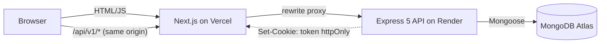

# Doctor Tracker — Clinical Administration Portal

> Doctor Tracker is a secure full-stack administration portal for managing hospital doctors and their assigned patients. It pairs index-backed prefix-token search, multi-facet filtering, and URL-synchronized pagination with an analytics dashboard that turns clinical admissions into actionable charts.

- **Demo Credentials:** `admin@doctortracker.dev` / `Admin@123456`

## Tech Stack
- **Frontend:** Next.js 15 (App Router), TypeScript, Tailwind CSS v4, TanStack Query v5, Recharts, Lucide Icons, Sonner
- **Backend:** Node.js, Express 5, TypeScript, MongoDB Atlas, Mongoose 8, Zod, JWT (`httpOnly` cookies), Helmet, Express Rate Limit

## System Architecture

## Key Technical Decisions

### 1. Prefix-Token Search (`nameTokens`) + Compound ESR Indexes
- **Context:** Unanchored case-insensitive regexes (`/term/i`) force a full collection scan (`COLLSCAN`) in MongoDB.
- **Decision:** Every Doctor and Patient document stores a lowercase `nameTokens` array generated from `name`, indexed via a multikey index. Search queries convert user input into anchored prefix regexes (`^term`) against `nameTokens`, `email`, and `phone`, while filter + sort queries use Equality-Sort-Range (`{ specialization: 1, createdAt: -1 }`, `{ condition: 1, createdAt: -1 }`) compound indexes.
- **Evidence:** Running `npm run explain` confirms `IXSCAN` winning plans where `TotalDocsExamined` equals `nReturned`.

### 2. First-Party `httpOnly` Cookie Auth via Next.js Rewrite Proxy
- **Context:** Hosting the frontend on `vercel.app` and the standalone Express API on `onrender.com` makes session cookies third-party, which modern browsers block under `SameSite=Lax` and prevents Next.js middleware from reading session state.
- **Decision:** Next.js `rewrites` proxy `/api/v1/*` requests from the frontend origin to the Express backend. The browser only communicates with its own origin, making the `httpOnly` JWT cookie strictly first-party while keeping Express as the true security gatekeeper on every route.
